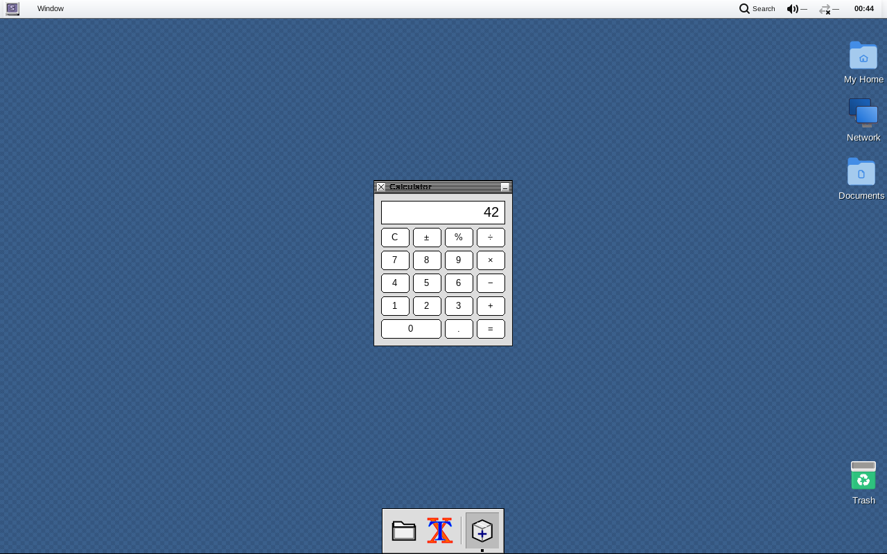

# SLOPOS-I

**Autonomous development entry:** [GOAL.md](GOAL.md) — one-shot
"deliver SLOPOS X11" task selection, checkpoints, low-reasoning QA
and storage limits. Implementations remain subject to
[real P1 release gates](docs/p1-x11-release.md), not agent claims.


SLOPOS-I is an experimental Linux desktop environment with a compact, Classic-Macintosh-inspired design ("Platinum Classic") on **X11**. It is written in Rust. Openbox manages the windows, and SLOPOS provides the session, a global menu bar, a Dock, settings and its own UI toolkit.

**Status: alpha.** It runs, and the pieces below work, but it is not ready for daily use and is nowhere near GNOME or KDE in coverage.



*A session from the CI smoke test (Xvfb, 1280×800, Openbox). Calculator shows 42 after `7*6=`. The Dock has two pinned apps and Calculator running and active; its icon is the generic one because the test tree has no desktop entry for it. This shows the session working, not a visual-conformance result.*

## What works today

- **Session:** `slopos-session` supervises Openbox, an optional compositor, the shell and the Dock. It restarts crashed components with backoff and has a real **Log Out**: it stops every session process and nothing is left behind.
- **Menu bar:**
  - the System menu, and desktop menus (New Folder, Empty Trash with confirmation, Control Panels, Software, About);
  - menus exported by GTK apps, and window actions for other apps;
  - live sound, network and battery status, and the clock.
- **Dock:** pinned and running apps, one dot per window, attention state. Click to launch, raise or cycle windows; middle-click starts a new instance.
- **Launcher:** Super+Space opens a fuzzy search over installed applications.
- **Notifications:** a built-in `org.freedesktop.Notifications` daemon.
- **Control Panels:** appearance (Platinum, Classic, Graphite, OLED), date and time, desktop and wallpaper, sound, and a **live network panel** that can turn networking and Wi-Fi on and off.
- **Software:** an AppImage catalogue and installer.
- **Calculator:** the first app on SLOPOS's own toolkit. Keyboard, mouse and screen readers all work.
- **SLOPOS toolkit** (`crates/slopos-ui`): software rendering, shaped text, PNG/SVG images, icon themes, an X11 window host with HiDPI scaling, and AT-SPI accessibility. No GTK.

Still incomplete: native Files drag and drop, icon view and removable volumes, native Terminal and Text editor; volume and brightness OSDs; workspaces UI; lock screen; display settings; Dock context menus and reordering. [docs/architecture.md](docs/architecture.md) explains how everything fits together and lists the gaps.

## Try it

**Nightly packages.** The nightly workflow builds packages on pushes to `main`, its daily schedule, and manual dispatch. Runs whose ref is `main` publish a `.deb` (Debian/Ubuntu) and a `.pkg.tar.zst` (Arch), with checksums, to the [`nightly` release](https://github.com/palaashatri/rust-slopos/releases/tag/nightly). Install one in a VM, log out, and pick **SLOPOS-I** in your display manager's X11 session list.

**From source:**

```bash
git clone https://github.com/palaashatri/rust-slopos.git
cd rust-slopos
sudo ./install.sh --distro ubuntu   # or --distro arch
```

Installing changes system files, so use a disposable VM while SLOPOS is alpha. Building and running the tests is safe anywhere; see [docs/development.md](docs/development.md).

There is no public APT or Pacman repository yet. Ignore anything that mentions `repo.slopos.org`.

## SLOPOS Intelligence preview

An opt-in local text-to-application-action prototype is available with Ollama and LFM3-1.7B. It validates structured model proposals against installed desktop entries and requires explicit confirmation for launches; it is not yet a background assistant, voice UI, or personal-context agent. See [docs/intelligence.md](docs/intelligence.md).

## Roadmap

Next steps, in priority order:

1. **Volume and brightness OSDs with media keys**, on the existing audio and brightness providers and drawn with the SLOPOS toolkit.
2. **More toolkit controls:** text field, menu/popup, list and scroll view. These unblock Dock context menus and native apps.
3. **Complete native Files, Terminal and Text editor** on the toolkit, replacing external defaults only after release gates.
4. **Dock settings:** pin/unpin, reordering and auto-hide, plus a Control Panels page for them.
5. **A bootable ISO** that boots to the session in QEMU, built and boot-tested in CI.
6. **Moving Settings and the shell off GTK 3**, one panel and surface at a time.

### Longer-term goals (planned, not implemented)

None of these block SLOPOS-I releases. Details are in contract §21.6–21.10 ([plan and vision](docs/contract/07-plan-and-vision.md)).

- **SLOPOS Intelligence:** an opt-in, local-first AI operator that visibly drives desktop apps through typed actions, accessibility semantics and bounded screen input. It verifies results, has an immediate stop control and asks before sensitive actions. Text first, voice later.
- **Personalization like Windows XP:** install whole visual themes, choose the layout separately (Dock or taskbar, global or per-window menus), and swap icon packs, fonts, accents, cursors and sounds without changing app code. Two built-in styles are planned:
  - the original **System 7/Platinum Classic**;
  - **SLOPOS Modern**, inspired by [Sinty / Singularity Desktop](https://sinty.dev/). Sinty is a visual reference only, not an asset source.
- **Icons:** the 12 symbolic glyphs for the planned app roster are present as [licensed SVG references](assets/icons/symbolic/app-symbols.json). Original colourful app icons are still to come.
- **Ecosystem:**
  - Integrate [Loom](https://github.com/palaashatri/rust-loom) Writer/Sheets/Present while Loom stays an independent cross-platform suite.
  - Offline Live Text, Copy Subject, Visual Look Up, dictation and writing tools, in the style of Apple Vision.
  - A SLOPOS-owned compositor for HDR/VRR, Spaces and live wallpapers.
  - SLOPOS as [PARAMA](https://github.com/palaashatri/parama)'s desktop, once that OS can host secure native apps.
- **Compatibility done properly:** run Windows apps through a verified Wine/Proton workflow; Raven stays an experimental evaluation. "It launches" is not enough: installation, real use, persistence, recovery and uninstall are tested per app and version, and GPU/display behaviour on real hardware.
- **Lessons from other systems:**
  - [Vinix](https://vinix-os.org/): user-space ABI compatibility and memory discipline.
  - [VitruvianOS](https://v-os.dev/): supervised sessions, metadata-aware Files and shared media APIs.
  - These are design references, not dependencies.
- **First-party apps:** only independently authored projects with verified rights can be bundled. The candidates are Loom, ClipKit, JWhisper, JVosk, JForge, PyForge, Donkey and ICStudio.
  - JTorch and Benchmarks stay independent tooling.
  - Tricycle and texture-auto-upscaler are upstream forks and are excluded.
- **Small devices:** the Raspberry Pi Zero 2 W (4× Cortex-A53, 512 MB RAM) is the low-end reference.
  - The approach: minimum, standard and accelerated capability tiers, lazy services, and memory and idle-CPU budgets.
  - The targets (e.g. ≥128 MiB `MemAvailable` at idle) are unverified until measured on the board.
- **2027 platform reality:** GNOME 50 dropped its X11 session, Plasma 6.8 is Wayland-only and GTK 4 has deprecated X11. SLOPOS-I stays on X11 for this generation and tracks the risks: which distributions still offer X11 logins, the GTK 3 bindings (the reason SLOPOS now has its own toolkit), Flatpak portals, WCAG 2.2-level accessibility and supply-chain hygiene.

## Design

The visual reference is the community [Classic Macintosh UI Kit](https://www.figma.com/design/LGMlwNCoVdakZxDBvPKg1W/Classic-Macintosh-UI-Kit--Community-?node-id=0-1&p=f) in Figma. SLOPOS uses it as a clean-room target for geometry, density, hierarchy and component states. It ships **no** Apple artwork, logos, fonts, sounds or copied assets.

The [SLOPOS Design Bible](docs/contract/02-design.md#52-slopos-design-bible--design-language-principles-tokens-and-review) (contract §5.2) sets the design language, principles, token architecture, theme matrix, anti-patterns and review checklist. Its structure comes from [Loom's Design Bible](https://github.com/palaashatri/rust-loom/tree/main/loom-design-bible). Its values come only from SLOPOS's own spec datasets. It also records how each inspiration is used:

- the Classic Macintosh UI Kit and System 7/Platinum;
- Sinty, for the future Modern style;
- Windows XP-class personalization;
- macOS-like usability conventions;
- Apple Vision-style workflows.

## Documentation

| Document | What it covers |
|---|---|
| [docs/architecture.md](docs/architecture.md) | What exists today: processes, crates, the toolkit, the Dock, the shell, packages and CI. |
| [docs/development.md](docs/development.md) | Building, testing, running a session from the source tree, QA scripts and releasing. |
| [docs/CONTRACT.md](docs/CONTRACT.md) | The engineering contract: target requirements by area, with the evidence ledger. |
| [AGENTS.md](AGENTS.md) | Short working rules for coding agents. |
| [packaging/browser/README.md](packaging/browser/README.md) | Browser integration. |
| [packaging/repo/README.md](packaging/repo/README.md) | Package-repository status and the plan for publishing. |

## License

MIT; see [LICENSE](LICENSE). Third-party software and assets keep their own licenses; see [THIRD_PARTY_LICENSES.txt](THIRD_PARTY_LICENSES.txt).
