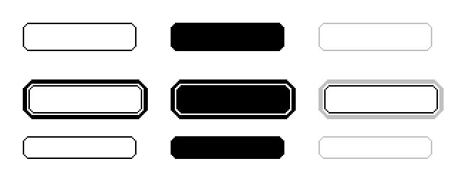

# SLOPOS-I

SLOPOS-I is an experimental Linux desktop environment focused on a coherent, compact Classic-Macintosh-inspired desktop experience on modern **X11** infrastructure.

The project is currently undergoing an **atomic UI and functionality reset**. The goal is not to approximate a retro look with a GTK theme; it is to define each primitive, control, interaction and workflow precisely, make it correct, then compose those verified pieces into the desktop.

## Current status

**Not release ready. Not production complete.**

The current tree contains a working architectural base and substantial QA/release infrastructure, but the 2026-09-24 audit found visual and functional gaps that must be corrected before the desktop can be considered mature.

The current implementation includes:

- an X11 session supervisor;
- Openbox window management;
- a SLOPOS shell and global top bar;
- application search/launcher;
- notifications;
- a Control Panels-style Settings application;
- an AppImage Software Catalogue;
- PCManFM-based desktop/file integration;
- X11 window/monitor integration;
- packaging and QA scripts.

Known current gaps include:

- the UI has not yet been rebuilt from the new Figma-derived atomic specification;
- several surfaces still contain modern rounded/shadow/card styling;
- Network Settings no longer shows sample data, but it only opens the external connection editor; live NetworkManager state is not shown yet;
- logging in from a graphical display manager (GDM, LightDM, SDDM) starts `slopos-session` directly and skips `start-slopos-i`, so that path has no global-menu export for GTK apps and no desktop icons (the `tuigreet` path is fine);
- the About dialog still describes the desktop as "consumer-ready", which it is not;
- file-browser visual conformance is not proven;
- canonical About and accessory utility surfaces are still missing;
- current build/runtime/visual evidence must be regenerated in a compliant Linux VM.

See [docs/CONTRACT.md](docs/CONTRACT.md#part-ii--current-audit-and-evidence-ledger) for the current evidence-backed audit and blocker ledger.

## Latest UI progress

Fresh Ubuntu 24.04 VM captures of the current SLOPOS UI button-plate gallery (2026-10-04):

| 1× | 2× |
| --- | --- |
|  |  |

These recaptures are pixel-identical to the October 2 captures; they document the current fixture, not a new visual change. The fixture draws only nine plate variants (Regular, Default and Secondary × Rest, Pressed and Disabled). It does not show text, interactive controls or accessibility behavior, and is not a Figma-conformance pass. The gallery source is now committed as `tools/slopos-ui-gallery` (2026-10-20); the images have not been recaptured from that commit. See [docs/CONTRACT.md](docs/CONTRACT.md#part-ii--current-audit-and-evidence-ledger) for task status.

## Roadmap

Next product steps, in priority order. Each one is something a person using SLOPOS-I would notice. Task-level detail and ownership live in [docs/CONTRACT.md](docs/CONTRACT.md) §21 and Part II.I; this list is a summary, not a separate plan.

1. **One login path that works everywhere.** Point the session descriptor at `start-slopos-i` so display-manager logins get the same global menu, desktop and wallpaper as `tuigreet` logins; this also turns the package CI green.
2. **Green CI on `main`.** Fix the two release-runner tests broken by the spec merge and the Arch `bsdtar` step, then find out why the Debian Live ISO fails.
3. **Live network status in Settings.** Show interfaces, connection names, addresses and Wi-Fi radio state from the existing `slopos-services` NetworkManager provider, then add joining a Wi-Fi network.
4. **The Dock.** It is a required shell surface and still missing; build it on `slopos-ui` rather than raw GTK.
5. **Volume and brightness OSDs with media keys**, using the existing audio and brightness providers.
6. **A first native app on `slopos-ui`** (Calculator is the smallest), as proof that the component library can carry a real app.
7. **A bootable install image a new user can try**: an ISO that boots to the SLOPOS-I session in QEMU, built and boot-tested in CI.

**Longer-term feature goal (not a SLOPOS-I release blocker): SLOPOS Intelligence.** An opt-in, local-first AI operator that visibly controls desktop applications through typed actions, accessibility semantics and bounded screen/visual input, with verification, an immediate stop control and consent for sensitive actions. Text-first; optional voice later. This is **planned, not implemented**. Architecture, scope and future acceptance milestones: [engineering contract §21.6](docs/CONTRACT.md#216-future-feature-goal--slopos-intelligence).

### Broader SLOPOS platform vision (planned, not implemented)

SLOPOS is intended to grow beyond the current X11/Openbox desktop without making those aspirations release blockers. The future directions are: a consistent SLOPOS-native UI toolkit with original **System 7/Platinum Classic** and future **Sinty-inspired SLOPOS Modern**, plus user-installable visual styles, layouts and icon packs (Loom's Design Bible can inform creative-suite integration); integration with [Loom](https://github.com/palaashatri/rust-loom) Writer/Sheets/Present while preserving Loom's independent Rust/Slint cross-platform suite; offline Vision-style **Live Text, Copy Subject, Visual Look Up, dictation and writing tools**; the **SLOPOS Intelligence** visible AI desktop operator; a later **SLOPOS-owned compositor** for HDR/VRR, Spaces, modern display scaling and live wallpapers; and [SLOPOS as PARAMA's intended desktop](https://github.com/palaashatri/parama), running above SURYA only when that independent OS can genuinely host secure native applications.

**Customization goal:** Windows XP-style freedom to install entire visual themes, configure taskbar/Dock/menu layout independently, and swap icon packs, fonts, accents, cursor/sound schemes without replacing app code. The [Sinty / Singularity Desktop](https://sinty.dev/) layout is the **Modern visual reference**, not an asset source. The 12 symbolic glyphs from the proposed SLOPOS app roster are now present as [licensed SVG reference assets](assets/icons/symbolic/app-symbols.json); original colorful Dock app icons and runtime integration remain to be implemented. The current SLOPOS-I design authority is still Platinum Classic.

These are **feature goals**, not current capabilities, dates or acceptance claims. Loom, PARAMA and SLOPOS stay in separate repositories with versioned interfaces and independent QA. See [§21.6–21.7 of the engineering contract](docs/CONTRACT.md#217-cross-generation-vision-slopos-as-a-coherent-desktop-platform).

### Compatibility and engineering quality

SLOPOS will favor **tested platform infrastructure over needless rewrites**, while owning a coherent native UI and typed integration APIs. On Linux, Windows applications should be supported through a verified **Wine/Proton** workflow; alternative runtimes such as Raven remain **experimental evaluations**, not shipped integration. A program merely launching is not compatibility: installation, real interaction, persistence, recovery and uninstall must be tested and reported per app/version. GPU/display behavior is validated separately on physical hardware.

Every subsystem requires reproducible positive and negative tests, explicitly scoped benchmarks, license/provenance review (including any copyleft obligations), and human-reviewed AI-authored diffs. Failures and unrun gates remain visible. See [engineering contract §21.8](docs/CONTRACT.md#218-platform-compatibility-reuse-and-evidence-discipline).

### Integration lessons and first-party ecosystem

Study [Vinix](https://vinix-os.org/) for user-space ABI compatibility and full-system memory discipline, and [VitruvianOS](https://v-os.dev/) for reliable Linux-backed desktop integration: session supervision, metadata-aware Files and common media APIs. These are *design references*, not copied dependencies or features claimed complete. See [contract §21.8.1–2](docs/CONTRACT.md#2181-lessons-from-vinix-and-vitruvianos--compatibility-and-low-latency-integration).

**Only independently authored projects with verified source/asset rights qualify as bundled first-party apps.** Candidate suite: Loom, ClipKit, JWhisper, JVosk, JForge, PyForge, Donkey and ICStudio; JTorch and Benchmarks belong in optional developer tools, not the default boot image. **Tricycle and texture-auto-upscaler are upstream forks and explicitly excluded.** Keep core installations minimal; make resource-heavy apps optional, and consider PARAMA targets only after actual platform/runtime bring-up.

## Canonical design direction

The visual/component reference is the community **Classic Macintosh UI Kit** in Figma:

`https://www.figma.com/design/LGMlwNCoVdakZxDBvPKg1W/Classic-Macintosh-UI-Kit--Community-?node-id=0-1&p=f`

SLOPOS uses that reference as a clean-room geometry, density, hierarchy and component-state target.

SLOPOS does **not** ship proprietary Apple artwork, logos, fonts, sounds or copied assets.

The canonical SLOPOS appearance is called **Platinum Classic**.

## Product architecture

```text
Linux services
  ├─ NetworkManager
  ├─ PipeWire / WirePlumber or compatible audio stack
  ├─ BlueZ
  ├─ UPower
  └─ systemd / logind
        ↓
X11
        ↓
Openbox
        ↓
slopos-session
        ↓
slopos-shell
  ├─ global menu/system bar
  ├─ launcher/search
  ├─ notifications
  └─ desktop integration
        ↓
slopos-settings
slopos-catalogue
normal X11 applications
```

SLOPOS-I is intentionally **X11-only** for this product generation. Wayland work is paused while the X11 desktop is brought to maturity.

## Development method

The project now develops bottom-up:

```text
foundation
→ primitive
→ control
→ container
→ window component
→ menu component
→ shell component
→ system provider
→ workflow
→ application
→ complete desktop
```

A higher-level surface is not considered finished while a lower-level component it depends on is still approximate.

The full engineering contract lives in [docs/CONTRACT.md](docs/CONTRACT.md); agent instructions are in [AGENTS.md](AGENTS.md).

## Development environment

SLOPOS project code must **not** be compiled or executed on the native host during local development.

All local:

- compilation;
- tests;
- linting/format validation;
- package builds;
- runtime testing;
- X11 testing;
- visual QA

must run inside a Linux VM hosted by **UTM, QEMU, VirtualBox or VMware**.

Ubuntu LTS is the preferred general development guest. Distribution-specific guests may be used for Debian/Ubuntu or Arch acceptance work.

The build clone and build output should live on guest storage, not a host shared folder.

Primary visual QA must be performed in a real graphical X11 session inside the VM. Xvfb/container testing may be used as a secondary deterministic layer inside the VM.

The project also enforces disk-space budgets so build caches, Rust targets, VM snapshots, package staging and media artifacts do not exhaust the host or guest. See [docs/CONTRACT.md](docs/CONTRACT.md) §29.

## Build from source

Source installation exists for development/testing. It is not yet the preferred consumer installation path.

Ubuntu/Debian-family development guest:

```bash
git clone https://github.com/palaashatri/rust-slopos.git
cd rust-slopos
sudo ./install.sh --distro ubuntu
```

Arch development guest:

```bash
git clone https://github.com/palaashatri/rust-slopos.git
cd rust-slopos
sudo ./install.sh --distro arch
```

After installation, select **SLOPOS-I** from the display manager's X11 session chooser.

Do this only inside a disposable or dedicated Linux VM while the project remains in active alpha development.

## Package repositories

There is currently **no public official SLOPOS-I APT or Pacman repository**.

Do not use documentation or commands that claim `repo.slopos.org` is a live package source.

Repository-generation infrastructure may exist in source, but public package-manager installation must not be advertised until signed repositories are actually published and verified.

## Useful project documents

- [AGENTS.md](AGENTS.md) — concise instructions for coding agents: commands, rules and workflow.
- [docs/CONTRACT.md](docs/CONTRACT.md) — engineering contract: requirements, architecture, plans, audit evidence and blockers.
- [packaging/browser/README.md](packaging/browser/README.md) — scoped upstream browser integration.
- [packaging/repo/README.md](packaging/repo/README.md) — current package-repository status and future publication contract.

Older screenshot sets have been removed to avoid presenting stale UI as current progress. The captures above are qualitative component-development snapshots, not product-acceptance evidence.

## License

SLOPOS-I is licensed under the MIT License. See [LICENSE](LICENSE).

Third-party software and assets retain their own licenses. See [THIRD_PARTY_LICENSES.txt](THIRD_PARTY_LICENSES.txt).
