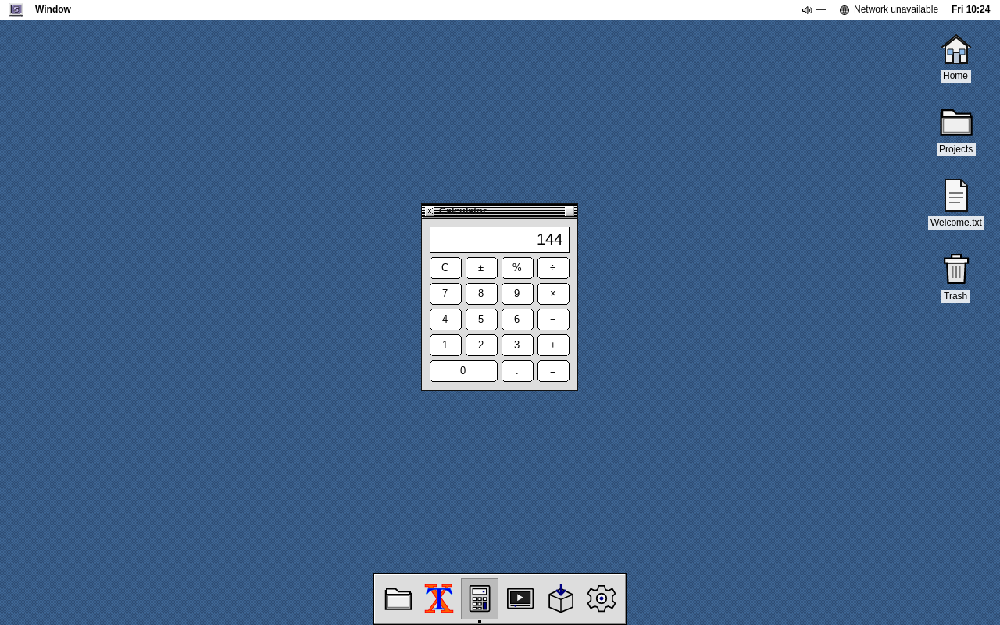

# Calculator (`slopos-calculator`)

The first native SLOPOS application, and the reference example for writing a
toolkit app. It is a small desk-style calculator with a 4-by-5 button grid
and a display.



*Captured 2026-11-27 in a real Xvfb session with Openbox and the Platinum theme
(`scripts/capture-p1-screenshots.sh`), after typing `12*12=`.*

## Features

- Digits 0–9, a decimal point, and the four operators `+ − × ÷`.
- Immediate execution, left to right, like a desk calculator: `2 + 3 × 4 =`
  gives **20**, not 14. Pressing `=` again repeats the last operation.
- `C` clears everything. `⌫` (Backspace) deletes the last digit.
- `±` negates the number on the display. `%` takes a percentage.
- Keyboard use: digits, `.` or `,`, `+ - * / x`, `%`, `=` or Enter for equals,
  Escape, Delete or `c` to clear, Backspace, F9 to negate, Tab to move focus
  between buttons, and Space or Enter to press the focused button.
- Every button is a toolkit `Button` with an accessible name, so screen readers
  can reach it.

## How it works

- `src/engine.rs` is a pure state machine. It takes an `Input` (a digit, an
  operator, `Equals` and so on) and returns the next display value. It has no
  dependency on X11 or the toolkit, so its tests run without a display.
- `src/main.rs` builds the window on `slopos-ui`: it lays out the buttons,
  turns key and pointer events into `Input` values, and paints the display. It
  implements `App::event`, `App::paint` and the accessibility tree, then calls
  `platform::run`.

## Running it

```sh
cargo run --locked -p slopos-calculator        # from the source tree
slopos-calculator                              # after install.sh
```

It is also in the Dock, the top bar's launcher (Super+Space or Ctrl+F2) and
the Calculator desktop entry.

## Tests

```sh
cargo test -p slopos-calculator
```

The engine tests cover arithmetic order, repeated equals, clearing, negation
and percentages. The window tests send key and pointer events and check the
result.

## Status and limits

- Calculator exports no menu bar yet, so the top bar shows only window actions
  while it is focused.
- No scientific functions and no calculation history.
- Protected regression: the Calculator is part of the session smoke test
  (`scripts/smoke-session.sh`), so a change that breaks it fails CI.
