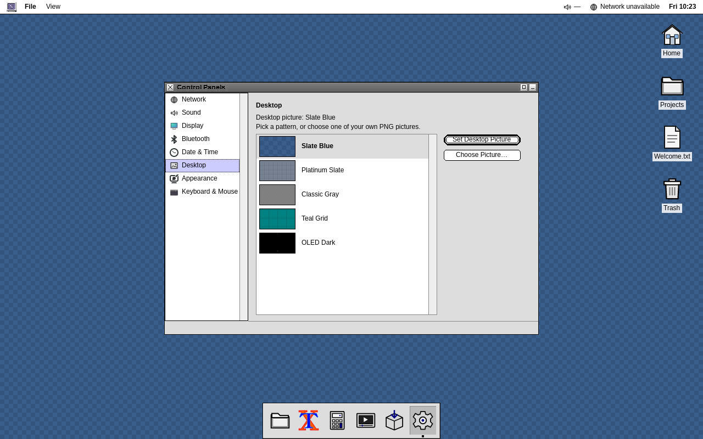
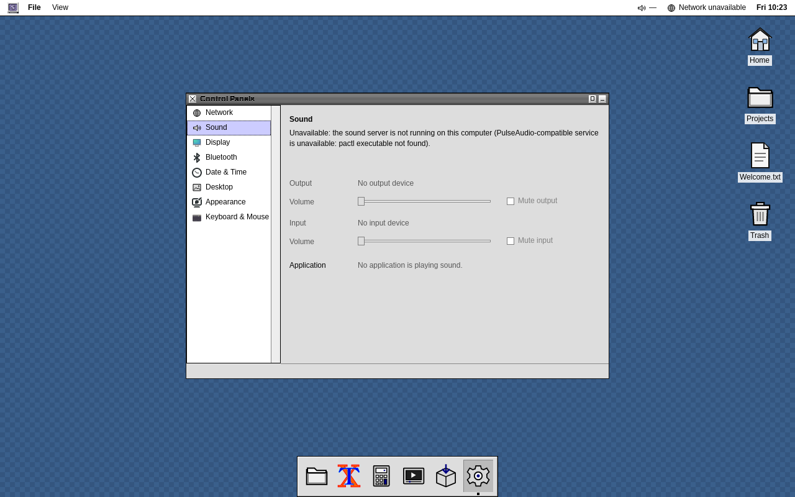
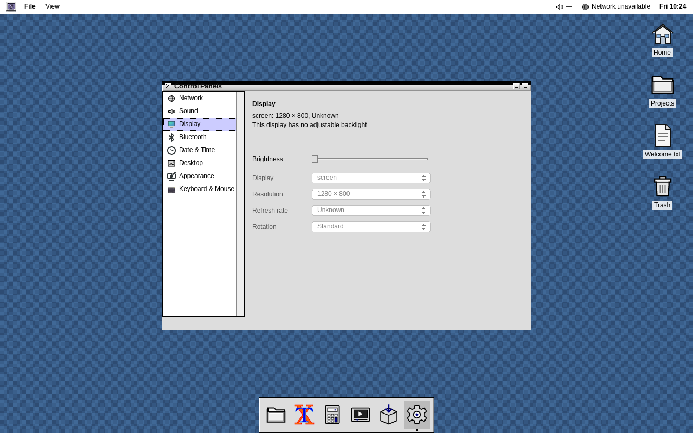
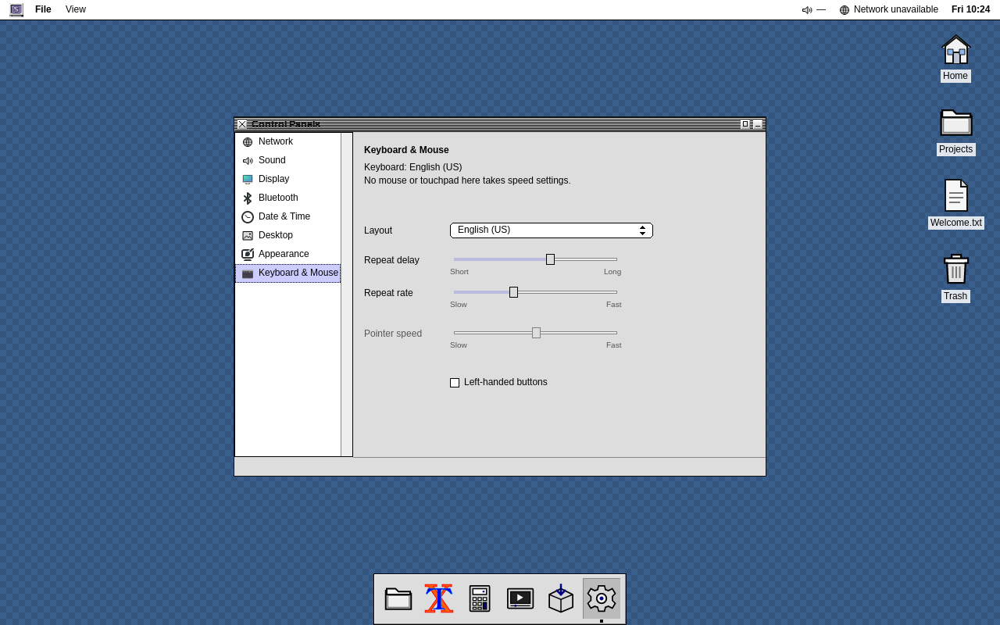

# Control Panels (`slopos-control-panels`)

The native system settings window. It has eight panels for the network, sound,
display, Bluetooth, date and time, desktop picture, appearance, and keyboard
and mouse. Each panel reads the real system state through `slopos-services`,
and says so when a service is missing.



*Desktop: the bundled patterns with thumbnails, Set Desktop Picture and Choose
Picture. Captured 2026-11-27 (`scripts/capture-p1-screenshots.sh`).*



*Sound, on a machine with no sound server. The reason is shown, and the controls
are disabled instead of showing fake levels.*



*Display, on Xvfb's single output. The real mode is shown, and pop-ups with only
one choice are disabled.*



*Keyboard & Mouse. Xvfb has no libinput pointer, so pointer speed is disabled
and the page says why.*

## Panels

- **Network:** Wi-Fi and networking toggles, a scan, and a list of networks
  that marks the connected and saved ones. Join asks for the password for a
  secured network with no saved profile, and checks the profile before
  activating it. Disconnect and Forget are also here.
- **Sound:** Output and Input device pop-ups, and volume and mute for the
  chosen devices. An Application section lists the playing applications, and
  can change each one's volume, mute it, or move it to another output.
- **Display:** backlight, and for each output the Display, Resolution, Refresh
  rate, Rotation and Position (right, left, above, below or mirror of the main
  display). Every change asks "Keep these display settings?" and reverts after
  15 seconds without an answer. Kept layouts are saved and applied again at
  login when the same monitors are connected.
- **Bluetooth:** adapter power, Search for Devices, the device list (connected,
  paired, then by name), Pair (Cancel Pairing while it runs), Connect,
  Disconnect and Forget.
- **Date & Time:** automatic time.
- **Desktop:** the bundled pictures, Choose Picture for your own PNG, saved to
  `~/.config/slopos-i/wallpaper` and repainted at once.
- **Appearance:** Platinum, Classic, Graphite or OLED.
- **Keyboard & Mouse:** keyboard layout (from the XKB list), repeat delay and
  rate, pointer speed and natural scrolling (when the device supports them),
  and left-handed buttons. Saved to `input.conf` and applied at login.

## How it works

- `src/services.rs` runs one Tokio runtime that connects to the
  `slopos-services` clients (NetworkManager, audio, BlueZ, timedated, brightness,
  RandR displays, and XKB and XInput input). It forwards their snapshots to the
  window and runs the changes. It blocks on the streams and the command channel,
  so it does not poll.
- A missing provider shows "unavailable" with the reason, and its controls are
  disabled.
- `src/model.rs` holds the panel state, separate from the window, so it can be
  tested without a display.
- `src/main.rs` is the window: the sidebar, the menus, and the pop-ups.

## Running it

```sh
cargo run --locked -p slopos-control-panels -- --sound
slopos-control-panels --network      # opens the Network panel
slopos-control-panels --display
slopos-control-panels --datetime
slopos-control-panels --desktop
slopos-control-panels --keyboard
```

The session runs `slopos-control-panels --restore` once at login, to apply the
saved display layout and keyboard and mouse settings. `--apply-displays` and
`--apply-input` apply just one of them.

## Keyboard shortcuts

- Ctrl+1 to Ctrl+8 switch to a panel.
- Ctrl+W closes the window.
- Tab skips pop-ups that have nothing to choose.

## Tests

```sh
cargo test -p slopos-control-panels
```

The tests check the text each panel shows (network, sound, display, Bluetooth,
date and time, appearance and input), the Wi-Fi target choice, the display
revert message, and that a missing provider gives its reason instead of values.

## Status and limits

- Not built: a network-secret agent for other applications, hidden networks,
  VPN, a Bluetooth pairing agent for PIN or passkey devices (those fail with
  BlueZ's error), time-zone selection, Dock settings and per-monitor scale.
- The status text is red only for real failures.
