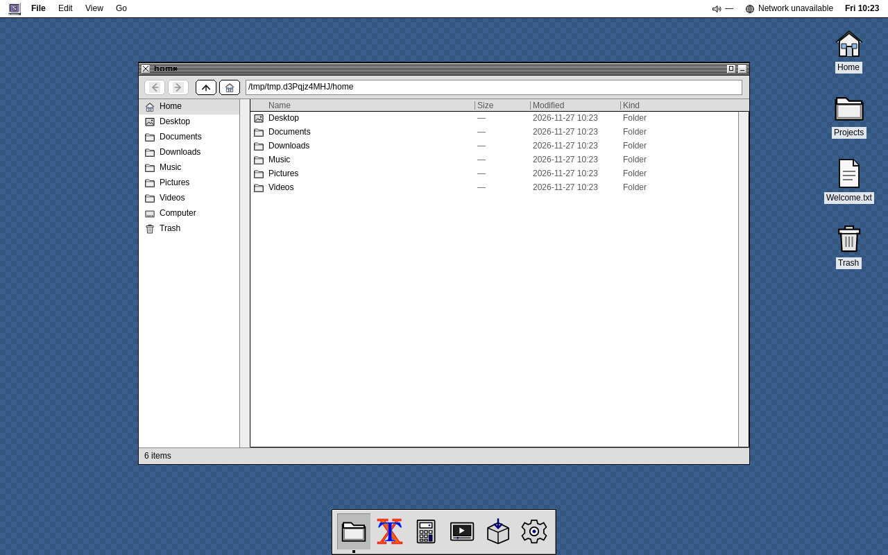
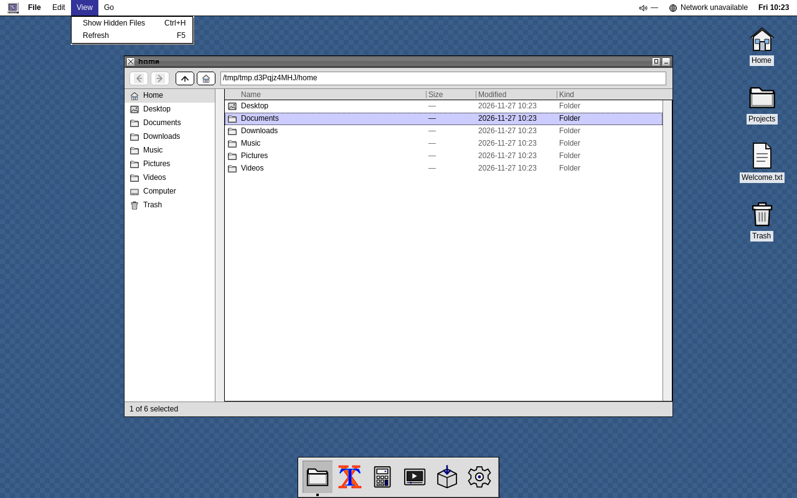

# Files (`slopos-files`)

The native file manager. It browses folders, opens files with their default
application, and does file operations with progress, cancel and conflict
handling. Trash, archives and removable-volume support are included.



*Captured 2026-11-27 in a real Xvfb session (`scripts/capture-p1-screenshots.sh`):
the Places sidebar, the theme's icons, the icon toolbar and the list view. The
menus are in the top bar, not in the window.*



*The View menu, opened from the top bar's global menus. Show Hidden Files is a
check item that follows Files' state.*

## Features

- **Browsing:** Back, Forward, Enclosing Folder and Home buttons; a location
  field (Ctrl+L); a Places sidebar (Home, the standard folders that exist,
  Computer and Trash) that follows navigation; hidden-file toggle (Ctrl+H).
- **List view:** Name, Size, Modified and Kind columns; single and multiple
  selection with Shift and Ctrl; type-ahead; double-click or Enter to open;
  right-click context menus.
- **Operations:** copy, move, rename and new folder (Ctrl+Shift+N). Each
  operation runs in its own thread with a progress bar and Cancel. A copy
  never replaces an existing file silently: the conflict dialog asks.
- **Trash:** Delete moves items to the Trash (freedesktop spec). The Trash view
  can restore items, delete them, or empty the Trash. Shift+Delete deletes
  permanently after a confirmation.
- **Archives:** Compress to zip or tar.gz; Extract Here for zip, tar, tar.gz,
  tar.xz and tar.zst. Extraction refuses absolute and `..` paths, and caps the
  number of entries and bytes.
- **Opening files:** uses the MIME default from `mimeapps.list`, or a desktop
  entry's `MimeType`, and falls back to `xdg-open`.
- **Live refresh:** an inotify watcher updates the listing when the folder
  changes.
- **Clipboard:** Ctrl+X, Ctrl+C and Ctrl+V within Files, plus Ctrl+A to select all.

## How it works

- `src/model.rs` lists a folder without following directory symlinks
  (`symlink_metadata`). A folder with more than 8192 entries fails with a clear
  message instead of showing a truncated list.
- `src/worker.rs` has one folder-reading thread (stale results are dropped), one
  thread per file operation, and the inotify thread. All of them wake the UI
  through the toolkit's `Proxy`. Nothing polls.
- `src/ops.rs` writes a copy under a private partial name and commits it with
  `renameat2(RENAME_NOREPLACE)`. Cancelling or failing removes only the partial
  file. Cross-device moves delete the source only after a committed copy.
- `src/trash.rs` implements the freedesktop Trash, and restore never overwrites.
- `src/archive.rs` runs archive work as operations with the same commit rules.
- `src/main.rs` is the window: menus, toolbar, sidebar, list, dialogs and status
  bar.

## Running it

```sh
cargo run --locked -p slopos-files -- ~/Documents   # open a folder
slopos-files                                        # Home
slopos-files --trash                                # the Trash view
```

The desktop's Trash icon opens `slopos-files --trash`, and folder icons open
Files on that folder.

## Keyboard shortcuts

| Shortcut | Action |
|---|---|
| Ctrl+O | Open the selection |
| Ctrl+Shift+N | New folder |
| Ctrl+L | Focus the location field |
| Ctrl+H | Show or hide hidden files |
| Ctrl+X / Ctrl+C / Ctrl+V | Cut, copy, paste |
| Ctrl+A | Select all |
| Ctrl+W | Close the window |
| Delete | Move to Trash (in the Trash view: delete permanently) |
| Shift+Delete | Delete permanently (asks first) |
| F2 | Rename |
| F5 | Refresh |
| Alt+Left | Back |

## Tests

```sh
cargo test -p slopos-files
```

The tests cover folder listing, archive round trips and hostile archives (path
traversal, links and size limits), the file-operation helpers, and the window's
commands.

## Status and limits

- Not built yet: drag and drop, icon view, thumbnails, a properties window,
  removable-volume mount and eject, and network mounts.
- It has not yet passed the installed-package VM acceptance tests. The
  [P1 release plan](../../docs/p1-x11-release.md) and
  [Files live QA](../../docs/p1-files-live-qa.md) list what is still required.
- The PCManFM donor stays in place until native parity is shown.
