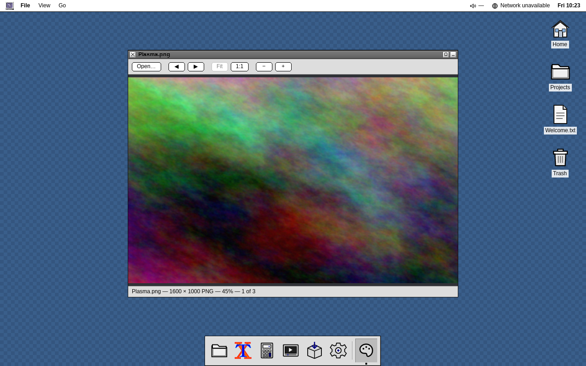

# Image Viewer (`slopos-image-viewer`)

The native image viewer. It opens PNG, JPEG, GIF, BMP, WebP, TIFF and SVG
files, and moves through the other images in the same folder.



*Captured 2026-11-27 in a real Xvfb session (`scripts/capture-p1-screenshots.sh`):
a generated 1600×1000 PNG, fitted, with the status line showing its size,
format, zoom and position in the folder.*

## Features

- **Formats:** PNG, JPEG, GIF (first frame), BMP, WebP (first frame), TIFF and
  SVG. The format is detected from the file's content, not its extension.
- **Orientation:** EXIF orientation is applied.
- **Navigation:** Previous and Next move through the folder in case-insensitive
  name order. The next image is decoded in advance.
- **Zoom and pan:** Fit, 1:1, zoom in and out (buttons, `+`/`-`, or the mouse
  wheel). Drag to pan. Double-click toggles Fit and 1:1.
- **Status line:** file name, dimensions, format, zoom and position in the
  folder.
- **Menus:** File, View and Go in the top bar when the session runs.

## How it works

- `src/decode.rs` decodes through the `image` crate with only the needed codecs
  enabled, and SVG through resvg. Before decoding it checks that the file is a
  regular file of at most 64 MB, and that the image is at most 40 megapixels
  and 32 768 pixels on a side. A decoder allocation limit guards against
  decompression bombs. The decoded images are kept in a 256 MB LRU cache.
- Decoding runs on a worker thread, which wakes the window when a frame is
  ready. The window never blocks on a decode.
- `src/main.rs` is the window: the toolbar, the Open dialog (filtered to
  images), keyboard and pointer handling, and the status line.

## Running it

```sh
cargo run --locked -p slopos-image-viewer -- ~/Pictures/photo.jpg
slopos-image-viewer ~/Pictures/photo.jpg           # after install.sh
```

## Keyboard shortcuts

| Key | Action |
|---|---|
| Left, PageUp, Backspace | Previous image |
| Right, PageDown, Space | Next image |
| Home / End | First / last image |
| `0` | Fit |
| `1` | 1:1 |
| `+` / `-` | Zoom in / out |
| Ctrl+O | Open |
| Ctrl+W or Ctrl+Q | Close |

## Tests

```sh
cargo test -p slopos-image-viewer
```

The tests cover decoding by content for each format, the size and dimension
limits, EXIF orientation, the folder order, the cache budget and the menus.

## Status and limits

- Not built: rotation and editing, a slideshow, a thumbnail grid, colour
  management (ICC profiles are ignored), animation playback for GIF and WebP
  (only the first frame is shown), and HEIF, AVIF and RAW.
- The P1 release plan asks for a full photo browser. This app is the PNG and
  SVG proof slice plus the other formats above, not a finished release. See
  [P1 release plan](../../docs/p1-x11-release.md).
