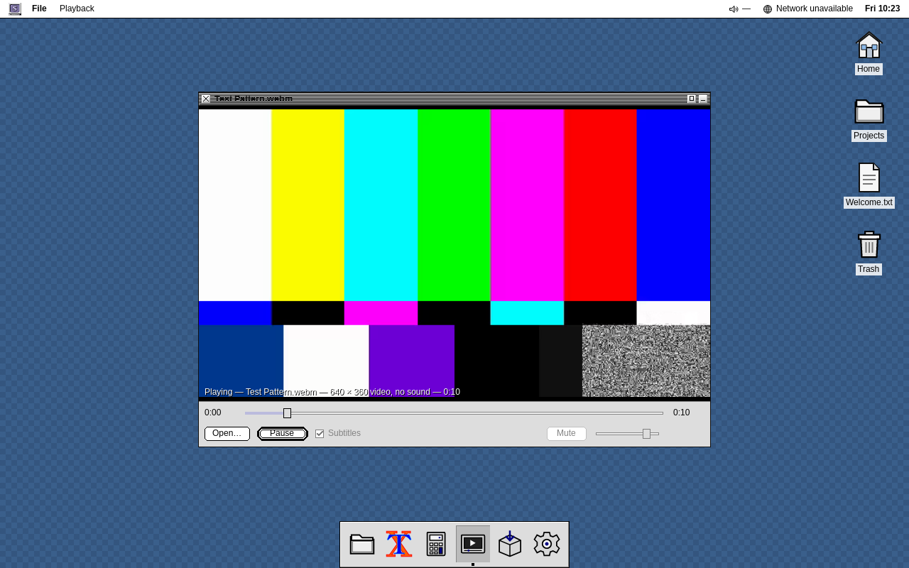

# Media (`slopos-media`)

The native video and audio player. It uses GStreamer for decoding and plays
video in its window with play/pause, seeking, volume and subtitles.



*Captured 2026-11-27 in a real Xvfb session (`scripts/capture-p1-screenshots.sh`).
The file is a 640×360 VP8 `videotestsrc` pattern generated by GStreamer. It has
no sound, so the window says so. The overlay line at the bottom of the picture
is the player's status text.*

## Features

- **Playback:** Play/Pause, a seek slider with the current and total time,
  a volume slider, and Mute.
- **Seeking:** Left and Right move back and forward 5 seconds.
- **Volume:** Up and Down change the volume in steps of 5%; `M` mutes.
- **Subtitles:** a sidecar file with the same name as the video and an `.srt`,
  `.vtt`, `.ass` or `.ssa` extension is loaded automatically. The Subtitles
  check box turns them on and off.
- **Honest errors:** an unknown format says so. A missing decoder names the
  codec and the package that usually provides it (for example
  `gstreamer1.0-libav` for H.264, H.265 and AAC, which SLOPOS does not ship).
- **Without audio:** with no sound server or ALSA device, audio goes to a
  synchronised fake sink, so the picture still plays.

## How it works

- `src/engine.rs` wraps GStreamer `playbin` behind an engine adapter. Video
  frames come out of an RGBA `appsink` (one frame buffered, the newest one
  wins). A bus thread turns GStreamer messages into events and wakes the window.
- `src/main.rs` is the window: the video area, the transport controls, the
  Open dialog (filtered to media files) and the keyboard shortcuts. A 250 ms
  timer runs only while playing.
- Nothing polls when the player is paused or idle.

## Requirements

- GStreamer 1.x with the base, good and x plugins for common formats
  (VP8, VP9, Vorbis, Opus). SLOPOS links GStreamer dynamically (LGPL-2.1 or later).
- H.264, H.265 and AAC need `gstreamer1.0-libav`, which SLOPOS does not
  install, so those files show a clear missing-codec message.

## Running it

```sh
cargo run --locked -p slopos-media -- ~/Videos/clip.webm
slopos-media ~/Videos/clip.webm                    # after install.sh
```

## Keyboard shortcuts

| Key | Action |
|---|---|
| Space or K | Play / pause |
| Left / Right | Back / forward 5 seconds |
| Up / Down | Volume up / down |
| M | Mute |
| Ctrl+O | Open |
| Ctrl+Q or Ctrl+W | Close |

## Tests

```sh
cargo test -p slopos-media
```

The tests run the real GStreamer pipeline on a generated test clip: open, play,
pause, seek, volume, mute and end of stream, plus broken files and subtitle
discovery. They need GStreamer installed.

## Status and limits

- Not built: playlists, full-screen, audio and subtitle track selection,
  hardware decoding, and embedded subtitle tracks.
- Video synchronisation is handled by GStreamer. It has not been measured on
  a Raspberry Pi or other low-end hardware.
