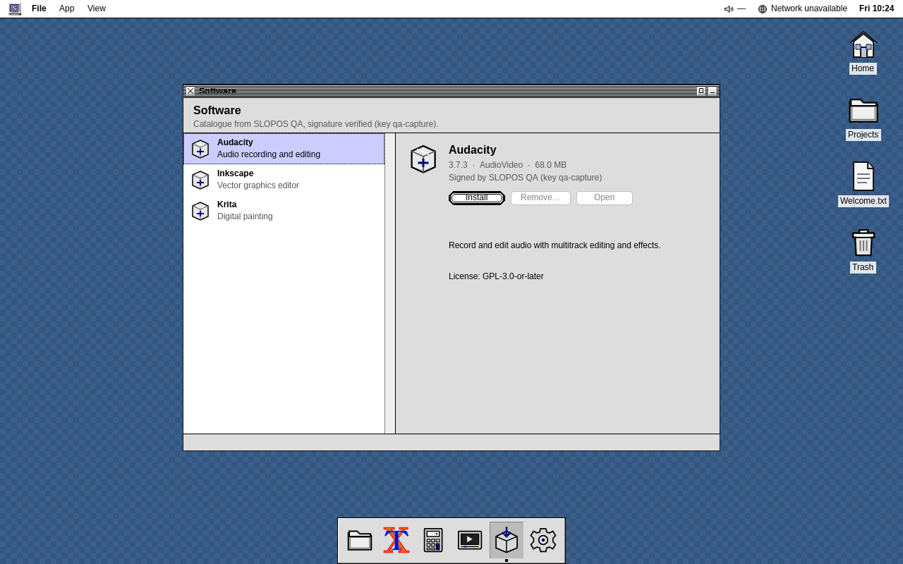

# Software (`slopos-software`)

The native software installer. It shows a catalogue of AppImage applications
and installs, updates and removes them. Every catalogue and every entry is
signed, and it checks the signature before it shows anything.



*Captured 2026-11-27 (`scripts/capture-p1-screenshots.sh`). The catalogue is a
QA fixture signed with a key generated for that capture. It is not a real
publisher's catalogue, and the window says so ("signature verified (key
qa-capture)").*

## Features

- **Signed catalogue:** the catalogue and each entry are Ed25519-signed, and
  checked against the trust store at `/etc/slopos-i/software/trust.json`. A
  missing or rejected catalogue offers nothing and says why.
- **Install, update and remove:** downloads over HTTPS to a partial file,
  checks the size, the SHA-256 and the ELF header, then commits the install.
  A failed or interrupted install is rolled back, and recovered at start-up.
- **Progress and cancel:** real byte progress and a Cancel button while
  downloading.
- **Installed apps:** lists the AppImages already installed, and can open or
  remove them even when the catalogue is missing.
- **Removal asks first.** Failures show the transaction's own error message.
- **Publisher command line:** `slopos-software keygen`, `sign` and `verify`
  create keys and sign or check a catalogue.

## Keyboard shortcuts

| Key | Action |
|---|---|
| Ctrl+I | Install the selected application |
| Ctrl+O | Open the selected application |
| Delete | Remove, when the list has focus |
| Escape | Cancel the running install |
| F5 | Reload the catalogue |
| Ctrl+W or Ctrl+Q | Close |

## How it works

- `src/trust.rs` loads the trust store and verifies signatures. It accepts
  only regular files that are not group- or world-writable.
- `src/store.rs` combines the verified catalogue for this architecture with the
  installed AppImages.
- `src/install.rs` runs the transactions, with a partial file and rollback.
- `src/window.rs` is the window: the list, the details pane, and the buttons.
  `src/main.rs` is the start-up code and the `keygen`, `sign` and `verify`
  commands.

## Running it

```sh
cargo run --locked -p slopos-software
cargo run --locked -p slopos-software -- keygen publisher.key
cargo run --locked -p slopos-software -- sign publisher.key catalogue.json
cargo run --locked -p slopos-software -- verify trust.json catalogue.json
```

## Tests

```sh
cargo test -p slopos-software
```

The tests cover the install, remove and cancel flows, and the window's list,
details and menus. Signature and trust-file checks are in `src/trust.rs`.

## Status and limits

- **No production catalogue or publisher key exists yet.** On a fresh system
  Software shows "No software catalogue is installed". Publishing one is an
  owner step.
- Not built: screenshots and ratings in the catalogue, automatic update checks,
  and distribution packages for Software itself.
