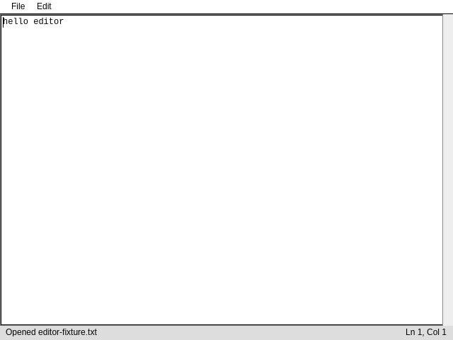
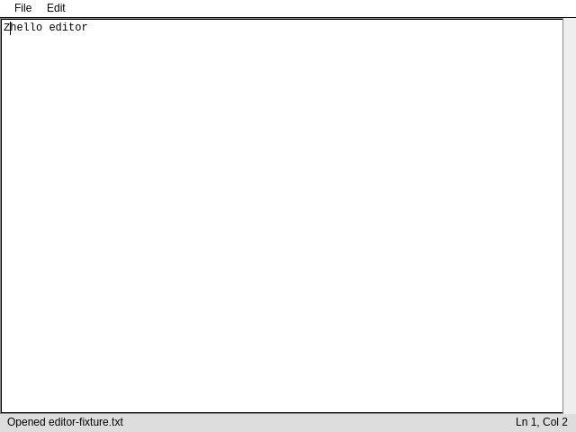

# Text Editor (`slopos-text-editor`)

A plain-text editor for SLOPOS-I, built on the SLOPOS toolkit (`slopos-ui`)
with no GTK. The text lives in `src/document.rs` (buffer, undo/redo, file
I/O, search) and the window uses the toolkit's multi-line `TextArea` control
(`crates/slopos-ui/src/controls/text_area.rs`).

## What it does

- **Files:** New, Open (file chooser), Save, and Save As. Save As asks before
  replacing an existing file: Cancel keeps the file, Replace overwrites it.
  Names with a slash, and names of folders, are refused with a message.
  Saves are atomic (a temporary file in the same folder, then a rename), and
  an existing file keeps its permissions.
- **Errors:** a failed open or save names the file and the reason, for example
  "you do not have permission to use it" or "it does not exist". Files over
  1 MiB and files that are not UTF-8 text are refused on open.
- **Unsaved changes:** New, Open and Close ask Save, Discard or Cancel first.
  The window title shows `*` while the document is modified.
- **Editing:** Cut, Copy, Paste and Select All use the toolkit clipboard.
  Typing a run of characters is one undo step.
- **Caret and selection:** Left, Right, Backspace and Delete move over whole
  grapheme clusters, so a letter with combining marks or an emoji with a skin
  tone is one unit. The status line shows `Ln` and `Col`, and the column
  counts the same units.
- **Find:** Ctrl+F opens a dialog, F3 or Ctrl+G finds the next match. Search
  is case-sensitive and wraps to the start.
- **Undo and redo:** Ctrl+Z, and Ctrl+Shift+Z or Ctrl+Y.

Keyboard shortcuts: Ctrl+N, Ctrl+O, Ctrl+S, Ctrl+Shift+S, Ctrl+W, Ctrl+Z,
Ctrl+Shift+Z, Ctrl+Y, Ctrl+X, Ctrl+C, Ctrl+V, Ctrl+A, Ctrl+F, F3, Ctrl+G.

Assistive technology sees the text as the text input's value, and the caret
and selection as positions in a `TextRun` child, one unit per grapheme
cluster.

## Limits

- No word wrap: long lines scroll horizontally.
- Find does not normalise Unicode and is case-sensitive.
- One document per window, one Classic (Platinum) palette.
- Saving needs write permission on the folder, because the atomic save
  creates a temporary file there. A writable file in a read-only folder cannot
  be saved.

## Verification

Run the CI commands from the repository's `AGENTS.md`. The results for this
app are:

| Check | Result |
| --- | --- |
| Unit tests: `document.rs`, `main.rs`, `text_area.rs` (undo, find, save, overwrite prompt, permission errors, grapheme selection, accessibility units, 1x pixel tests) | PASS on CI run 46139675879 (head `28c57f51`) and run 46140267054 (head `4cbc3955`) |
| Permission-denied test (read-only folder, unreadable file) | PASS in the CI Tests step of run 46139675879; the test fails when run as root, so this is a non-root pass |
| Session smoke: the editor opens a fixture, its text is painted in a 1x screenshot, a typed character marks the document modified, Ctrl+S writes the file, Ctrl+W quits with status 0 and no panic (`scripts/smoke-session.sh`) | PASS on CI run 46143478501 (head `41cd8af9`); artifact `session-smoke` |

Screenshots from that smoke run (CI run 46143478501, head `41cd8af9`):

Fixture loaded, 1x, from the smoke check.

After typing Z, from the same smoke run.

### NOT_RUN

- The 2x editor screenshot.
- The AT-SPI walk-through of the editor's controls.
- Design Bible review of the editor's visible UI (AGENTS.md rule 9).
- Debian and Arch package builds, and the installed-package journey.
  The package workflows check only the payload list that includes the editor.
