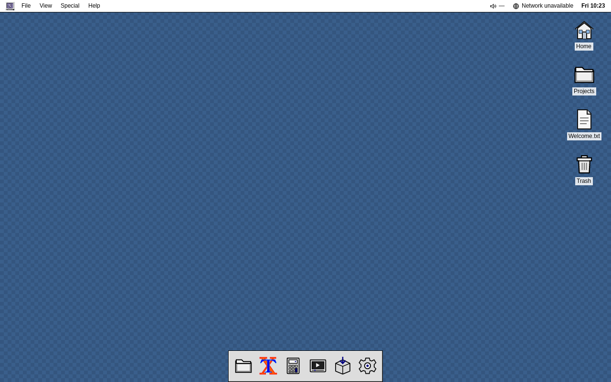
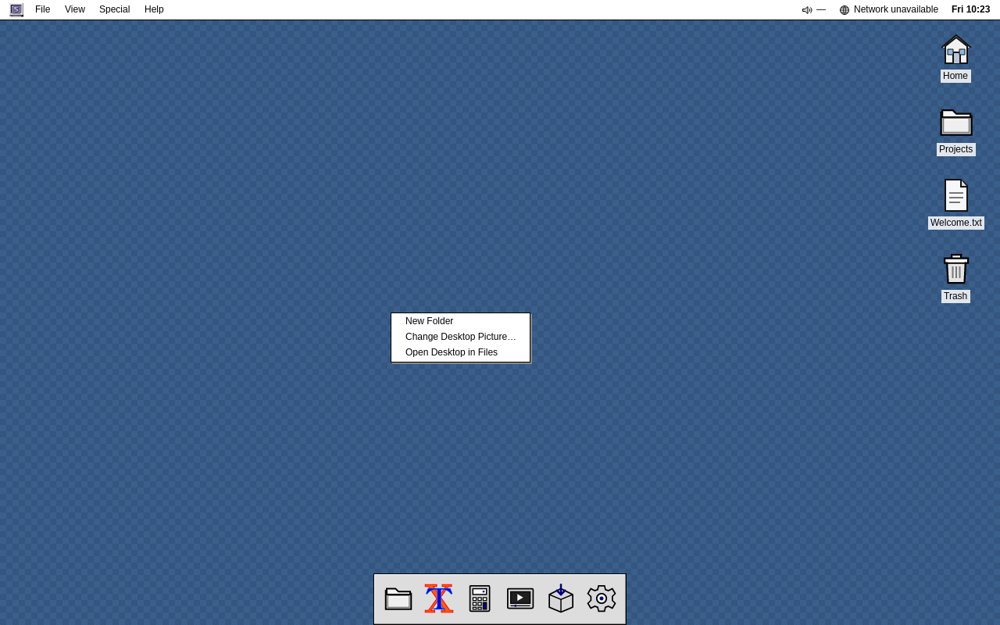

# SLOPOS desktop (`slopos-desktop`)

The desktop window. It sits under every other window, shows the desktop picture,
and places icons for Home, mounted volumes, the desktop folder and the Trash.



*Captured 2026-11-27 (`scripts/capture-p1-screenshots.sh`): Home, Projects and
Welcome.txt from `~/Desktop`, Trash, the top bar's desktop menus, and the Dock.*



*Right-click on empty desktop: New Folder, Change Desktop Picture… and Open
Desktop in Files.*

## Features

- **Picture:** shows the root picture that `slopos-session` paints. It re-reads
  the picture when the root changes, and follows screen-size changes. The desktop
  looks the same with or without this program.
- **Icons:** Home, removable volumes under `/media` and `/run/media`, the items of
  `XDG_DESKTOP_DIR` (hidden files skipped, at most 400), and the Trash (shows
  full or empty). Icons start in the top-right corner. Positions you drag them to
  are kept in `~/.config/slopos-i/desktop-positions`.
- **Selection:** click and Ctrl-click; drag to a free cell; arrow keys and
  type-to-select.
- **Opening:** double-click, Return or Ctrl+O. Folders, volumes and Home open in
  Files. The Trash opens `slopos-files --trash`. Files open with their default
  application.
- **New folder:** Ctrl+Shift+N creates one, and never replaces an existing folder.
- **Context menu:** New Folder, Change Desktop Picture… (opens Control Panels) and
  Open Desktop in Files.
- **Assistive technology:** the icons are a list of list items.

## How it works

- `src/main.rs`: the desktop window, the picture, the icon layout and input.
- `src/model.rs`: the icon list, positions and the desktop folder contents.
- `src/watch.rs`: inotify on the desktop folder and the Trash, and
  `/proc/self/mountinfo` for mounts. Refresh is driven by events and nothing polls.

## Running it

```sh
cargo run --locked -p slopos-desktop
slopos-desktop      # started by slopos-session; SLOPOS_NO_DESKTOP leaves it out
```

## Tests

```sh
cargo test -p slopos-desktop
```

The icon layout, positions and selection logic are tested without a display.

## Status and limits

- Not built: rename, Move to Trash and drag and drop between the desktop and
  Files; mounting unmounted volumes; one desktop window per monitor.
