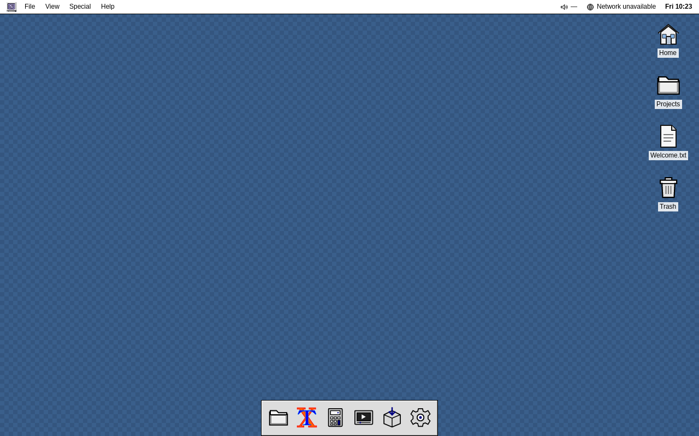

# SLOPOS session supervisor (`slopos-session`)

The program that turns an X11 login into a SLOPOS desktop. It starts Openbox
and SLOPOS's own desktop programs, restarts them if they crash, and stops them
at log-out.



*Captured 2026-11-27 in a real Xvfb session (`scripts/capture-p1-screenshots.sh`).
The picture is painted by `slopos-session --paint-desktop`. The top bar, the
desktop icons and the Dock are the programs the session starts.*

## What it does

- **Start-up:** `start-slopos-i` (run by `packaging/slopos-i.desktop`) sets up
  D-Bus activation and the share directory, then runs `slopos-session`.
- **Single instance:** takes a lock file at
  `$XDG_RUNTIME_DIR/slopos-session<display>.pid`, so a second copy refuses to start.
- **Saved settings:** runs `slopos-control-panels --restore` once, for at most
  five seconds, so the saved display layout and keyboard and mouse settings apply
  before anything sizes itself to the screen.
- **Environment:** sets the `XDG_*` paths, the GTK theme and the Openbox config
  for the chosen appearance (Platinum, Classic, Graphite or OLED). A user's own
  `~/.config/slopos-i/openbox/rc.xml` takes priority.
- **Desktop picture:** paints the saved picture, or the appearance's colour, on
  the X root window. `--paint-desktop` repaints it after a change.
- **Supervision:** Openbox is required, and its failure ends the session. The
  top bar and the Dock are important and restart with a back-off (250 ms × 2ⁿ).
  After five fast failures in a row a program is given up, and that is reported
  once. The desktop picture program and the compositor are optional.
- **Log-out:** `slopos-session --logout` sends SIGTERM to the running supervisor,
  which stops the children in reverse order (SIGKILL after 2 s if needed). The
  Openbox root menu and the top bar's System menu use this.

## Process tree

```
start-slopos-i ─► slopos-session
                   ├─ slopos-control-panels --restore   once, ≤ 5 s
                   ├─ openbox               required
                   ├─ picom / xcompmgr      optional, skipped if missing
                   ├─ slopos-desktop        optional, off with SLOPOS_NO_DESKTOP
                   ├─ slopos-topbar         important
                   └─ slopos-dock           important, off with SLOPOS_NO_DOCK
```

Applications started from the top bar, the desktop or the Dock are detached,
reaped, and not supervised by the session.

## Running it

```sh
slopos-session --version
slopos-session --paint-desktop     # repaint the desktop picture
slopos-session --logout            # stop the running session
```

`SLOPOS_NO_COMPOSITOR`, `SLOPOS_NO_DESKTOP` and `SLOPOS_NO_DOCK` leave out the
optional programs.

## Files

- `src/main.rs`: command line and the start-up sequence.
- `src/supervisor.rs`: child processes, restart back-off and shutdown order.
- `src/environment.rs`: environment variables and the appearance files.

## Tests

```sh
cargo test -p slopos-session
```

## Status and limits

- Tested under Xvfb by the smoke test (`scripts/smoke-session.sh`), which logs
  in, checks the top bar, desktop, Dock and Calculator, logs out, and checks that
  every process has exited.
- Not tested on real login managers or hardware in this repository. The live ISO
  test boots the session in QEMU.
