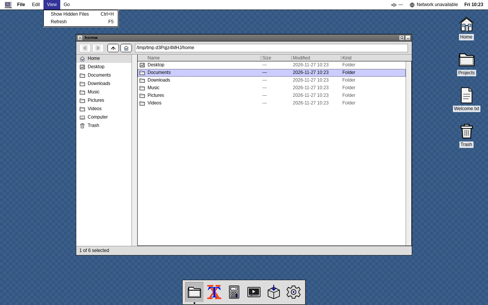
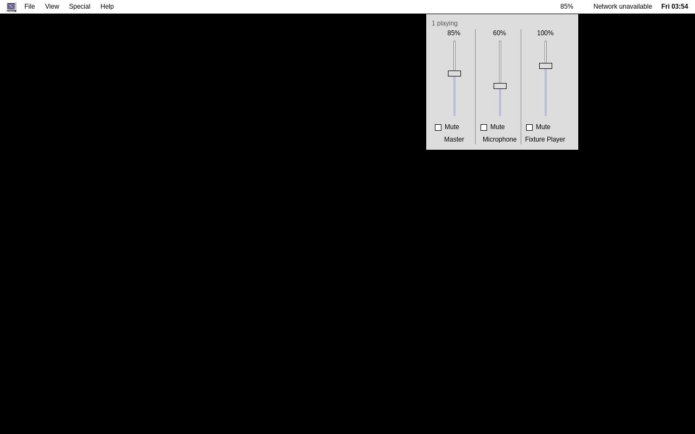

# SLOPOS top bar (`slopos-topbar`)

The strip across the top of the screen. It holds the System menu, the global
menus of the focused window, the status items (sound, network, battery,
clock), the launcher and the notification toasts.



*Captured 2026-11-27 (`scripts/capture-p1-screenshots.sh`). Files' menus appear
in the top bar, not in the window. Here the View menu is open.*



*Captured 2026-11-06 with `scripts/qa/topbar-mixer.sh`. A click on the sound item
opens the mixer under it, right-aligned.*

## Features

- **Window:** a 26-pixel dock-type window across the top, with a strut that
  reserves the space. One top bar per display; a second copy refuses to start.
- **System menu:** About, Control Panels, Software, Volume Mixer, Desktop
  Picture, the appearance choices, Switch User, and Log Out, Restart and Shut
  Down (with confirmation).
- **Global menus:** shows the focused window's menus. It imports the menu model
  that the window exports, so SLOPOS toolkit apps and GTK applications both
  appear here. Choosing an item runs the app's action. Desktop menus (File, View,
  Special, Help) show when the desktop has focus. Windows with no exported menus
  get Close, Minimise and Zoom.
- **Status items:** sound (volume and mute), network (connection name, Offline,
  or Network unavailable), battery when there is one, and the clock. They come
  from `slopos-services` on a background thread. A missing service shows as
  unavailable.
- **Volume Mixer popover:** the same mixer as the standalone app, under the sound
  item. It reconnects to the sound server when opened, so a server that started
  later is found without a restart.
- **Launcher:** fuzzy search over the installed applications. Open it with
  Super+Space (Openbox sends SIGUSR1) or Ctrl+F2, or from the System menu.
- **Notifications:** an `org.freedesktop.Notifications` 1.2 server. Notifications
  appear as toasts under the bar's right end, three at a time, and support
  actions, expiry, replacement and closing.

## How it works

- `src/main.rs`: the bar window and its event loop.
- `src/menus.rs`: the System menu and the desktop menus, built as toolkit popup
  menus with keyboard navigation.
- `src/status.rs`: the status thread and its providers.
- `src/launcher.rs` and `src/desktop_files.rs`: the application index and the
  search.
- `src/notifications.rs`: the notification server and the toasts.
- `src/windows.rs` and `src/session.rs`: the focused window and the session
  commands (log-out and restart).

## Running it

```sh
cargo run --locked -p slopos-topbar     # on a running X session
slopos-topbar                            # started by slopos-session
```

## Tests

```sh
cargo test -p slopos-topbar
bash scripts/qa/topbar-mixer.sh <x-of-sound-item>   # popover under Xvfb
```

## Status and limits

- Not built: status popovers for Wi-Fi, Bluetooth, battery and the clock (the
  sound popover is the only one), volume and brightness OSDs, a notification
  history, and multi-monitor bars.
- The earlier GTK 3 shell is still in the workspace but is no longer started
  (see [`slopos-shell`](../slopos-shell/README.md)).
