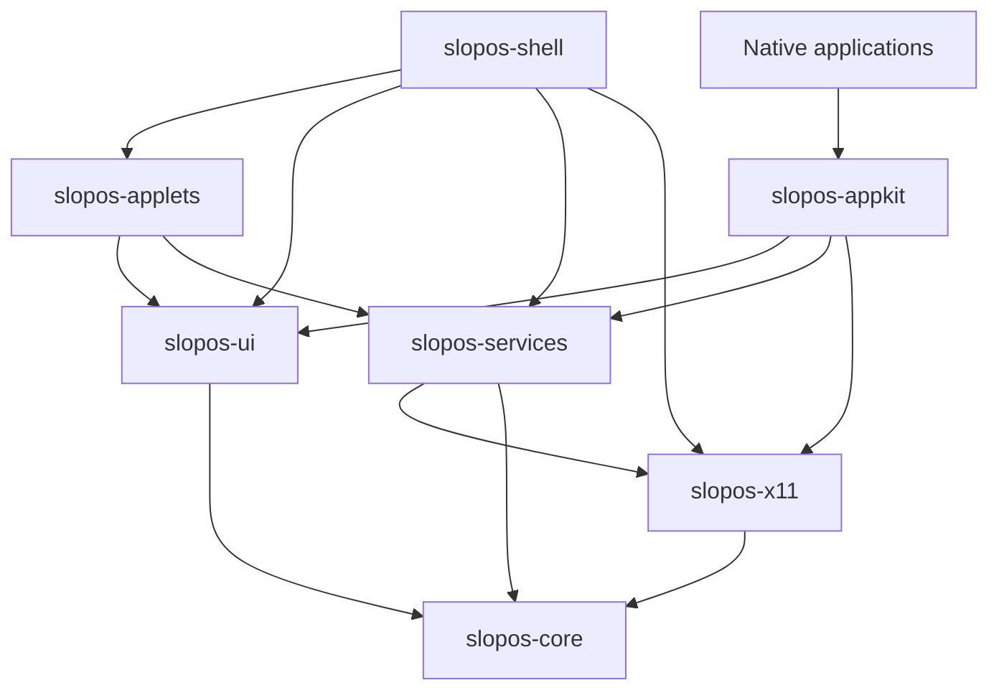
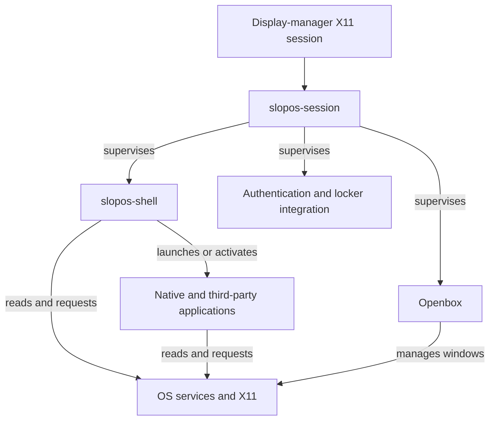
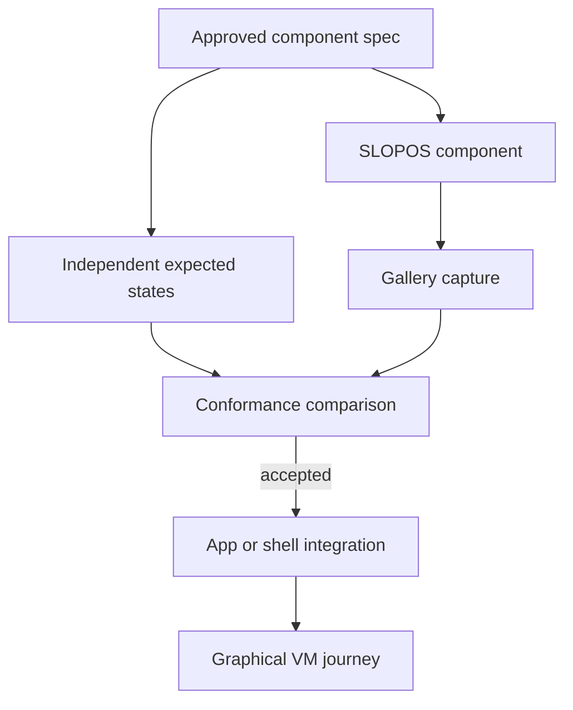
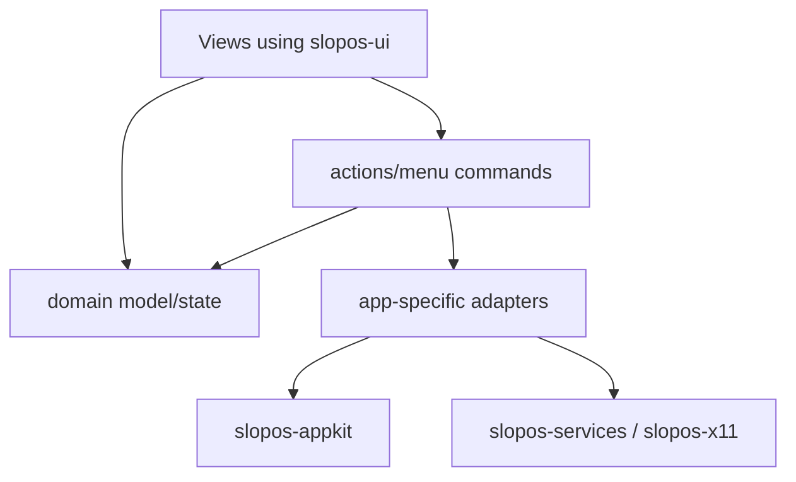

<!-- Part of the SLOPOS-I engineering contract; index: ../CONTRACT.md -->

# 6. High-level architecture

SLOPOS has design/UI, application, platform-service, shell and session/runtime layers. Preserve these boundaries while migrating the existing four crates.

## 6.1 Design and implementation authority

The Figma reference and approved SLOPOS extension specs feed `qa/spec/classic/`. Those definitions drive `slopos-ui` implementations and independent conformance assertions. `slopos-appkit`, shell surfaces and apps compose verified controls. Spec-derived assertions must not simply call the same implementation formula they are supposed to check.

## 6.2 Shell-to-provider rule

A domain has one authoritative backend implementation and shared typed contracts, consumed by any number of views. For example, Volume applet, OSD, Sound panel and media keys use the same AudioProvider API. They may not implement independent `pactl`, `amixer` or PipeWire behavior.

“One provider” means consistent ownership and API, not necessarily one new daemon for the whole desktop. Within a process share its provider instance. Across processes use the same adapter implementation and subscribe/read back from the real OS service; a dedicated SLOPOS daemon is justified only when a recorded requirement needs it. Shell restarts must resubscribe instead of inventing state.

Minimum provider contract:

| Concern | Required behavior |
|---|---|
| Availability | Distinguish loading, available, unsupported hardware, missing service, permission denied, disconnected and failed. Never substitute fixture values. |
| Snapshot/events | Typed state with stable device IDs and an update revision; subscribe without leaking callbacks on reconnect. Handle hotplug and service-owner changes. |
| Command | Typed request, capability/authorization check, bounded completion, error propagation and cancellation where meaningful. |
| Mutation result | Show pending state; confirm success by authoritative reply/read-back or event. Roll back optimistic UI if the action fails. |
| Concurrency | Serialize/conflict-resolve writes to the same device; discard stale completions after device removal or a newer request. |
| Test seam | Injectable transport/clock/filesystem where needed. Fixture data is only available to tests/gallery, never a production fallback. |
| Credentials | Secret-agent integration; no credentials in logs, screenshots or command lines. |

System I/O and blocking D-Bus work do not run on the UI thread. GTK/GDK/Pango objects remain on their required main thread; worker results cross through typed messages. Bound queues and define shutdown/cancellation ownership before adding background loops.

## 6.3 Dependency direction

**Every arrow below means “depends on”; runtime ownership is shown separately in §6.4.**



Apps may also consume typed services directly for domain-specific operations. No lower layer imports apps, shell or applets. `slopos-core` has no GUI/system-service dependencies. `slopos-x11` is UI-free; `slopos-services` is UI-free and may use it for display state. Engine adapters expose SLOPOS-owned APIs and may not leak raw GTK widgets into app code.

`slopos-session` supervises processes; it must not depend on UI libraries to keep a broken UI from preventing recovery. The graph describes allowed dependencies, not an instruction to add every dependency to every crate.

## 6.4 Runtime process topology



The display manager/Xorg own the X server lifecycle; Openbox is a window manager, not the X server. Shell modules initially share one process with explicit state/lifecycle boundaries. Their UI, model and provider contracts must allow later process isolation without a desktop rewrite.

Session startup establishes the session bus, launches supervised components, detects crash loops with bounded backoff, and offers a recoverable failure path. Restarting the shell/WM must not terminate unrelated applications, duplicate global grabs or lose their window/menu state. Test clean logout, bounded shutdown and recovery separately.

## 6.5 UI construction pipeline



There is no application-specific styling step. For Dock, OSD or other absent reference compositions, write a SLOPOS extension spec built from canonical atoms before production UI implementation. Missing Figma access blocks exact extraction/conformance for affected atoms; it does not block unrelated provider, VM or QA work.

## 6.6 Extensibility contracts

Use `SystemProvider`, `SystemApplet`, `ShellSurface`, `ControlPanel`, `Application` and shared `Action` concepts. Add later capabilities through those interfaces rather than miscellaneous shell conditionals. HDR/VRR/color management require a separately validated backend/capability plan; no generic XRandR toggle or VM fixture proves them. Live wallpaper requires lifecycle, resource-budget and fullscreen behavior evidence before exposure.

# 7. Target repository structure

These are **target paths**, not a claim they already exist. Part II lists the current four-crate workspace. Every Rust crate has `Cargo.toml` and `src/lib.rs` and/or `src/main.rs`; the module directories below live beneath `src/`, not next to the manifest.

| Path | Owned modules/responsibilities |
|---|---|
| `crates/slopos-core/` | config, errors, IDs, XDG paths, build metadata, capability/IPC identifiers |
| `crates/slopos-ui/` | foundation, render, input, layout, primitives, controls, containers, menus, dialogs, views, accessibility, theme, testing |
| `crates/slopos-appkit/` | lifecycle, actions, menus, documents, undo, clipboard, drag/drop, file dialogs, recent items, MIME, restore, jobs, errors |
| `crates/slopos-x11/` | connection, EWMH, windows, monitors/RandR, workspaces, selections and input |
| `crates/slopos-services/` | network, audio, brightness, Bluetooth, power, media, session, timedate, displays, printers, storage/removable media, applications, input; additional Control Panel providers as required |
| `crates/slopos-applets/` | framework and per-domain models/presenters: Wi-Fi/VPN, Bluetooth, volume, brightness, battery, displays, keyboard, media, removable media, notifications, clock |
| `crates/slopos-session/` | process supervision and recovery |
| `crates/slopos-shell/` | desktop, global menu, Dock, launcher, notifications, OSD, status area, workspace/session UI and shell IPC |
| `apps/` | files, control-panels, terminal, notes, calculator, software, system-monitor, screenshot, system-information, image-viewer, archive-utility, disks, fonts, help, media, documents |
| `utilities/` | auth/locker adapters, shortcuts/media keys, clipboard, removable media, wallpaper, chooser/default-apps, display confirmation, secrets/pairing, URI/desktop-entry launch, session dialogs |
| `tools/` | `slopos-ui-gallery`, `slopos-conformance`, `slopos-qa-driver`, `figma-spec-import` as needed |
| `qa/` | `spec/classic/`, goldens, interaction tests, journeys, fixtures; raw run output follows §30 |
| `assets/`, `themes/` | reviewed clean-room assets and transitional GTK/Openbox theme integration |
| `packaging/`, `scripts/`, `.github/workflows/` | install/release integration and gate runners |

The utility inventory describes responsibilities, not a requirement for a separate process/crate per row. Keep shortcuts and media-key registration under one runtime owner. Keep file dialogs in appkit rather than duplicating them in a Files-only implementation.

New app Cargo package names should consistently use `slopos-<app-name>`; directory and executable compatibility changes are coordinated with packaging. Do not rename the four legacy crates before their replacements preserve session/install behavior. Central manifest/module registration belongs to the coordinator. Prefer focused modules with private implementation details over large shared files.

# 8. slopos-core

`slopos-core` contains shared non-UI, non-platform primitives.

It may define:

- application IDs;
- stable IPC identifiers;
- common result/error types;
- XDG path handling;
- configuration serialization;
- version/build metadata;
- resource lookup;
- logging conventions;
- capability descriptors.

It must not depend on GTK.

It must not become a dumping ground for unrelated helpers.

# 13. Platform integration libraries

## 13.1 slopos-x11

Maintain one authoritative X11 layer using `x11rb` and stable X11 mechanisms.

It owns:

- active window;
- EWMH state;
- root properties;
- window metadata;
- workspaces;
- monitor/RandR model;
- work area;
- placement;
- input integration where appropriate;
- clipboard/selection integration where appropriate.

Do not use `xdotool`, `xprop`, `wmctrl` or `xrandr` as high-frequency polling infrastructure.

Tests may use those tools to drive an isolated VM session.

## 13.2 slopos-services

System providers must be typed and testable.

Required provider modules:

- NetworkManager;
- audio;
- BlueZ;
- UPower/logind;
- timedate;
- display/RandR;
- CUPS/IPP printers;
- removable media/udisks/GIO;
- storage;
- session;
- default applications;
- MIME database;
- desktop entry/application index.

Providers expose real state and real actions.

No provider may return sample state in production.

Fixtures are allowed only behind test-only code paths.

# 19. Native application anatomy

Every native application should follow a common internal structure:

```text
apps/<name>/
├── Cargo.toml
├── src/
│   ├── main.rs
│   ├── app.rs
│   ├── actions.rs
│   ├── menu.rs
│   ├── model/
│   ├── services/
│   ├── views/
│   └── tests/
└── resources/
```

Recommended layering:



Views must not directly shell out to command-line tools.

Views must not contain system-provider logic.

# 20. Architectural enforcement

Add automated architecture tests.

At minimum enforce:

- first-party app crates do not directly depend on `gtk`, `gdk`, `pango` or arbitrary CSS files;
- first-party app UI goes through `slopos-ui`/`slopos-appkit`;
- duplicated UI constants are rejected where practical;
- production source does not contain known fixture/sample SSIDs, IP addresses or hardware labels;
- there is one global-menu implementation;
- no new `xdotool` runtime application-action injection;
- no enabled empty callbacks;
- no TODO placeholder controls in release-visible code.

Record each temporary exception in Part II.N with exact path, reason, owner, test and removal task. Do not create a competing architecture document or allow whole new app directories to bypass the boundary.

Inspect Cargo metadata by resolved package identity (including dependency aliases) and combine it with source/behavior checks; a grep for `gtk::Button` alone is not enforcement. Test-only fixture strings are allowed in test fixtures; production sample values are not. Keep domain logic testable without initializing GTK.

Legacy crates initially need a bounded migration exception. Freeze the exception list at the audited baseline; no new raw-GTK surface is allowed under it. Narrow/delete entries as migration lands. An exception is acknowledged debt, never a conformance pass.

QA-01 must also check task path ownership, specification completeness, Markdown policy, duplicate menu ownership, and unregistered required gates. Until that checker exists, the coordinator reviews these constraints manually and records the limitation.
